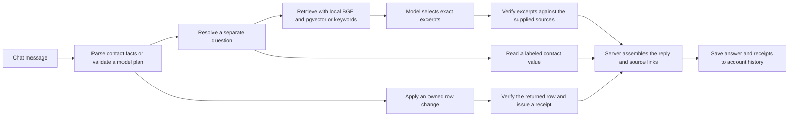

# 🧠 AI Second Brain

An AI notebook for remembering personal facts, searching saved notes, and checking the evidence behind an answer. Chat updates a note in place and links to the saved change.

🔗 **Live Demo:** https://ai-second-brain-beige.vercel.app/


---

## ✨ Features

| Feature                     | Description                                                                  |
| --------------------------- | ---------------------------------------------------------------------------- |
| 🔐 **Authentication**       | Email/password sign-up & login via Supabase Auth                             |
| 📝 **Add + Edit Memories**  | Create, update, and delete memories with automatic re-embedding              |
| 🏷️ **Tagging**              | Add tags to memories and filter your notes by tag/search                     |
| 🔍 **Vector Search**        | Semantic retrieval using local BGE embeddings + pgvector cosine similarity |
| 🤖 **RAG Q&A**              | Ask questions and get excerpts verified against your stored notes           |
| 💬 **Chat Memory**          | Save facts or correct a stored value from chat and open the updated note     |
| 📌 **Source Evidence**      | Answers include source notes and evidence snippets with term highlighting    |
| 🕘 **Question History**     | Reopen saved answers or rerun a question in read-only mode                   |
| 👤 **Multi-user Isolation** | RLS policies ensure each user only accesses their own memories               |
| 🛡️ **Provider Resilience**  | Contact updates and exact recall work during a model outage                  |

---

## 🏗️ Architecture



The API can answer a question and apply a separate update in the same turn. Existing note edits use an optimistic database check so a chat request cannot overwrite an intervening manual edit. When OpenRouter is unavailable, general questions show matching source notes and exact contact operations use the notebook directly.

### Tech Stack

| Layer            | Technology                                      |
| ---------------- | ----------------------------------------------- |
| **Frontend**     | Next.js 14 (App Router), React 18, Tailwind CSS |
| **Backend**      | Next.js API Routes                              |
| **Auth**         | Supabase Auth (email/password)                  |
| **Database**     | Supabase PostgreSQL                             |
| **Vector Store** | Supabase pgvector (cosine similarity)           |
| **Embeddings**   | ONNX Runtime, `BAAI/bge-small-en-v1.5` (384 dims) |
| **LLM Gateway**  | OpenRouter                                      |
| **Deployment**   | Vercel                                          |

### Data Model (Current)

```sql
Table: public.memories
┌─────────────┬──────────────────┬───────────────────────────────────────────────┐
│ Column      │ Type             │ Notes                                         │
├─────────────┼──────────────────┼───────────────────────────────────────────────┤
│ id          │ uuid             │ Primary key (gen_random_uuid)                 │
│ user_id     │ uuid             │ FK -> auth.users (CASCADE DELETE)             │
│ title       │ text             │ Optional memory title                          │
│ content     │ text             │ Full note content                              │
│ tags        │ text[]           │ Optional tags (default '{}')                  │
│ embedding   │ vector(384)      │ BGE embedding output                           │
│ created_at  │ timestamptz      │ Auto-set on insert                             │
└─────────────┴──────────────────┴───────────────────────────────────────────────┘
```

---

## 🚀 Getting Started

### Prerequisites

- **Node.js** 18+ and **npm**
- A **Supabase** project ([free tier](https://supabase.com) works)
- An **OpenRouter** API key

---

### 1) Clone & Install

```bash
git clone https://github.com/kudala-bharani/ai-second-brain.git
cd ai-second-brain
npm install
```

---

### 2) Configure Environment Variables

Copy `.env.local.example` to `.env.local` and set:

```env
NEXT_PUBLIC_SUPABASE_URL=https://your-project-ref.supabase.co
NEXT_PUBLIC_SUPABASE_ANON_KEY=your-supabase-anon-key
OPENROUTER_API_KEY=sk-or-v1-your-openrouter-key
NEXT_PUBLIC_APP_URL=http://localhost:3000
```

Where to get them:

| Variable                        | Location                                                                 |
| ------------------------------- | ------------------------------------------------------------------------ |
| `NEXT_PUBLIC_SUPABASE_URL`      | Supabase Dashboard -> Project Settings -> API                            |
| `NEXT_PUBLIC_SUPABASE_ANON_KEY` | Supabase Dashboard -> Project Settings -> API (`anon` key)               |
| `OPENROUTER_API_KEY`            | [openrouter.ai/keys](https://openrouter.ai/keys)                         |

---

### 3) Set Up Database

In Supabase SQL editor, run:

1. `supabase/schema.sql`
2. `supabase/migration_feature_upgrade.sql` (required for latest memory editing/tags/security updates)

`migration_feature_upgrade.sql` includes:

- `tags` column on `memories`
- `UPDATE` RLS policy for own memories
- Hardened `match_memories` (bound to `auth.uid()`)

---

### 4) Run Locally

```bash
npm run dev
```

Open [http://localhost:3000](http://localhost:3000)

---

## Try the chat workflow

1. Add a note with `Phone: 2025550101` in the body. The title can be blank.
2. Ask “What is my phone number?” and open the source from the answer.
3. Send `I changed to a new number, this is my current number "2025550102"`. Open the receipt to inspect the edited note.
4. Start a new chat and ask the same question. The answer comes from the saved value.

## Regression tests

Run `npm test` to exercise the chat pipeline with synthetic notebook records and controlled provider and database responses. The suite checks persistent corrections, idempotent retries, conflicts, provider failures, fabricated confirmations, and automatic capture.


---

## ⚙️ Configuration Notes

- Embeddings use the existing **384-dimensional BGE model** locally, with CLS pooling and L2 normalization. The checked-in [ONNX export](https://huggingface.co/Xenova/bge-small-en-v1.5/tree/ea104dacec62c0de699686887e3f920caeb4f3e3) is pinned to that model.
- Each saved answer, source citation, and memory receipt lives in `query_history` under the signed-in account.
- Set `OPENROUTER_MODELS` to a comma-separated list of preferred models that support structured output. The free router is available as a fallback.

---

## 🧪 Useful API Endpoints

| Route                      | Purpose                                   |
| -------------------------- | ----------------------------------------- |
| `GET /api/test-embedding`  | Check that the local embedding model loads |
| `GET /api/memories`        | Fetch user memories                       |
| `POST /api/memories`       | Create memory (title/content/tags)        |
| `PATCH /api/memories/:id`  | Edit memory + re-embed                    |
| `DELETE /api/memories/:id` | Delete memory                             |
| `POST /api/query`          | Ask a grounded question or change a memory from chat |
| `GET /api/query-history`  | List answers saved to the signed-in account |

---

## 🚢 Deployment (Vercel)

Set these environment variables in Vercel project settings:

- `NEXT_PUBLIC_SUPABASE_URL`
- `NEXT_PUBLIC_SUPABASE_ANON_KEY`
- `OPENROUTER_API_KEY`
- `NEXT_PUBLIC_APP_URL`

---

## 📧 Email Verification Setup

After deploying to Vercel, you need to configure Supabase email verification to work with your production domain.

### Quick Setup:

1. **Get your Vercel URL** (e.g., `https://your-app-name.vercel.app`)

2. **Update Supabase Dashboard:**
   - Go to **Authentication** → **URL Configuration**
   - Set **Site URL** to your production URL
   - Add to **Redirect URLs**:
     ```
     http://localhost:3000/auth/callback
     https://your-app-name.vercel.app/auth/callback
     ```

3. **Update Vercel Environment Variable:**
   - Add `NEXT_PUBLIC_APP_URL=https://your-app-name.vercel.app`

4. **Test:** Sign up with a new email and verify the link redirects correctly

📖 **Detailed guide:** See [SUPABASE_EMAIL_SETUP.md](./SUPABASE_EMAIL_SETUP.md) for complete instructions, troubleshooting, and multi-environment setup.

---

## 🔒 Security

- RLS on `memories` enforces per-user data isolation
- Server-side user checks in API routes via `supabase.auth.getUser()`
- Provider keys remain server-side
- `.env.local` is gitignored and should never be committed

---

## 📄 License

MIT

---

<div align="center">
Built with Next.js, Supabase, OpenRouter, and ONNX Runtime.
</div>
