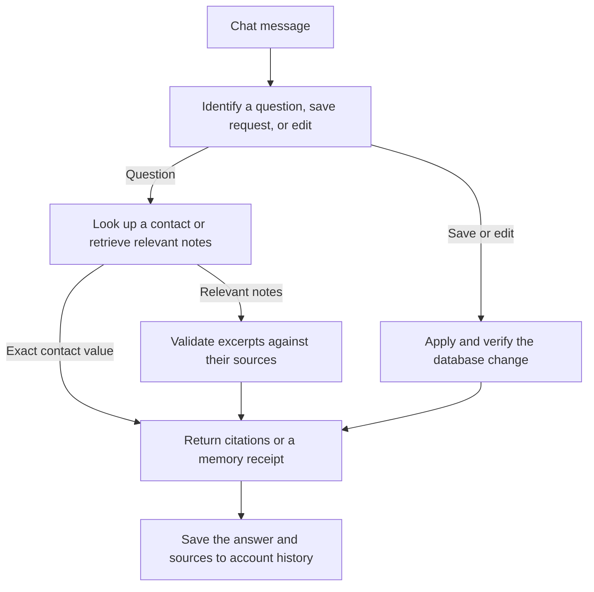

# AI Second Brain

A personal notebook you can talk to. Save notes and details you want to remember, ask questions in your own words, and open the notes that support an answer. Chat can also update a saved detail and link you to the changed note.

[Live demo](https://ai-second-brain-beige.vercel.app/) · [Try a chat update](#try-a-chat-update) · [Run locally](#run-locally)

## Features

| Feature | What you can do |
| --- | --- |
| **Notebook** | Add, edit, and delete notes with optional titles and comma-separated tags. Search by title or content, or filter by tag. |
| **Workspace** | Chat and browse memories side by side on desktop. Open **Add memory** beside the chat, or jump to **Memories** on a phone. |
| **Ask and verify** | Search your notes in plain language. Copy an answer, expand a citation to see its excerpt, and open the original note. |
| **Remember from chat** | Ask chat to save a fact, or enable **Auto-save facts** to let it capture supported details you share. Explicit save and update requests still work with auto-save off. |
| **Correct a saved detail** | Update a matching note in place. For supported contact updates, chat can ask for a missing replacement and accept just that value in the next reply. Confirm the change through **Memory updated** and **Open memory**. |
| **History** | Reopen recent saved answers and their citations. **Ask again** runs in read-only mode. **New chat** starts a fresh conversation using the same notebook. |

Accounts use Supabase email and password sign-in. Notes and the latest 10 answers shown in **History** belong to the signed-in account. History stores individual answers and their evidence. The active chat thread lives in the browser.

## Try a chat update

1. Select **Add memory** and save a note containing `Phone: 202-555-0101`.
2. Ask `What is my phone number?` and open the cited note.
3. Send `Change my phone number`. When chat asks for the new number, reply `202-555-0102` in the same chat.
4. Select **Open memory** in the **Memory updated** confirmation. Start a **New chat** and ask for the number again to check that the updated value persists.

## How it works



- **Retrieval** uses local ONNX inference to create 384-dimensional BGE embeddings and pgvector cosine similarity to find relevant notes. Keyword search can find notes when vector retrieval is unavailable or a note has no embedding.
- **Answers** use OpenRouter to select relevant excerpts. The server checks that cited excerpts occur in the referenced notes. It can show matching note previews if the model is unavailable, and supported labeled phone and email lookups work without OpenRouter.
- **Writes** change the matched database row. A pending contact correction keeps a snapshot of its target note. If the note changes before the reply arrives, the edit is rejected so a newer value is preserved. A combined message can update a note and ask a separate question.

The app uses Next.js 14, React 18, TypeScript, and Tailwind CSS. Supabase provides Auth, PostgreSQL, and pgvector. ONNX Runtime runs the [bundled BGE model](src/models/bge-small-en-v1.5), OpenRouter provides model inference, and Vercel hosts the app.

Supabase row-level security scopes `memories` and `query_history` to the signed-in user. The app computes embeddings on the server. Model-backed requests may send the question and relevant note excerpts to OpenRouter. Keep the OpenRouter key server-side.

## Run locally

Use Node.js 24, npm, a Supabase project, and an OpenRouter key for model-backed features.

### 1. Install dependencies

```bash
git clone https://github.com/kudala-bharani/ai-second-brain.git
cd ai-second-brain
npm ci
cp .env.local.example .env.local
```

### 2. Set up Supabase

In a fresh project's SQL Editor, run [`supabase/schema.sql`](supabase/schema.sql) once. It creates the notes, history, ownership policies, and vector search function. [`migration_feature_upgrade.sql`](supabase/migration_feature_upgrade.sql) is for older databases that lack those features.

Give authenticated sessions the table access that the app needs for the Data API. The schema's row-level security policies continue to enforce ownership. [Supabase Data API grants](https://supabase.com/changelog/45329-breaking-change-tables-not-exposed-to-data-and-graphql-api-automatically)

```sql
grant select, insert, update, delete on table public.memories to authenticated;
grant select, insert on table public.query_history to authenticated;
```

If email confirmation is enabled, add `http://localhost:3000/auth/callback` to the Supabase redirect allowlist. For a hosted deployment, set **Site URL** to your public origin and add its exact `/auth/callback` URL as well. Keep the default confirmation email template. [Supabase redirect settings](https://supabase.com/docs/guides/auth/redirect-urls)

### 3. Configure the app

Set these values in `.env.local`. [Example environment file](.env.local.example)

| Variable | Value |
| --- | --- |
| `NEXT_PUBLIC_SUPABASE_URL` | Your Supabase project URL |
| `NEXT_PUBLIC_SUPABASE_ANON_KEY` | The project's public API key, either publishable or legacy anon |
| `OPENROUTER_API_KEY` | Your [OpenRouter key](https://openrouter.ai/keys) |
| `OPENROUTER_MODELS` | Optional comma-separated model IDs that support structured output. Defaults to `openrouter/free`. |
| `NEXT_PUBLIC_APP_URL` | Optional app origin used for OpenRouter request attribution. Defaults to `http://localhost:3000`. |

### 4. Start the app

```bash
npm run dev
```

Open [http://localhost:3000](http://localhost:3000). For Vercel, set the same environment variables in the project and use the deployment origin for `NEXT_PUBLIC_APP_URL`.

## Tests

`npm test` runs the chat regression suite with synthetic notebook records and mocked database, embedding, and model calls. It covers follow-up corrections, retries, stale notes, read-only history, provider outages, and false write confirmations.

`npm run build` creates a production build. After starting the app, `GET /api/test-embedding` checks that the local model loads.

## API routes

| Route | Purpose |
| --- | --- |
| `GET /api/memories` | List signed-in user's notes |
| `POST /api/memories` | Add a note |
| `PATCH /api/memories/:id` | Edit a note and refresh its embedding |
| `DELETE /api/memories/:id` | Delete a note |
| `POST /api/query` | Ask a question or request a notebook change |
| `GET /api/query-history` | Retrieve recent saved answers |
| `GET /api/test-embedding` | Check local embedding health |

## License

MIT
